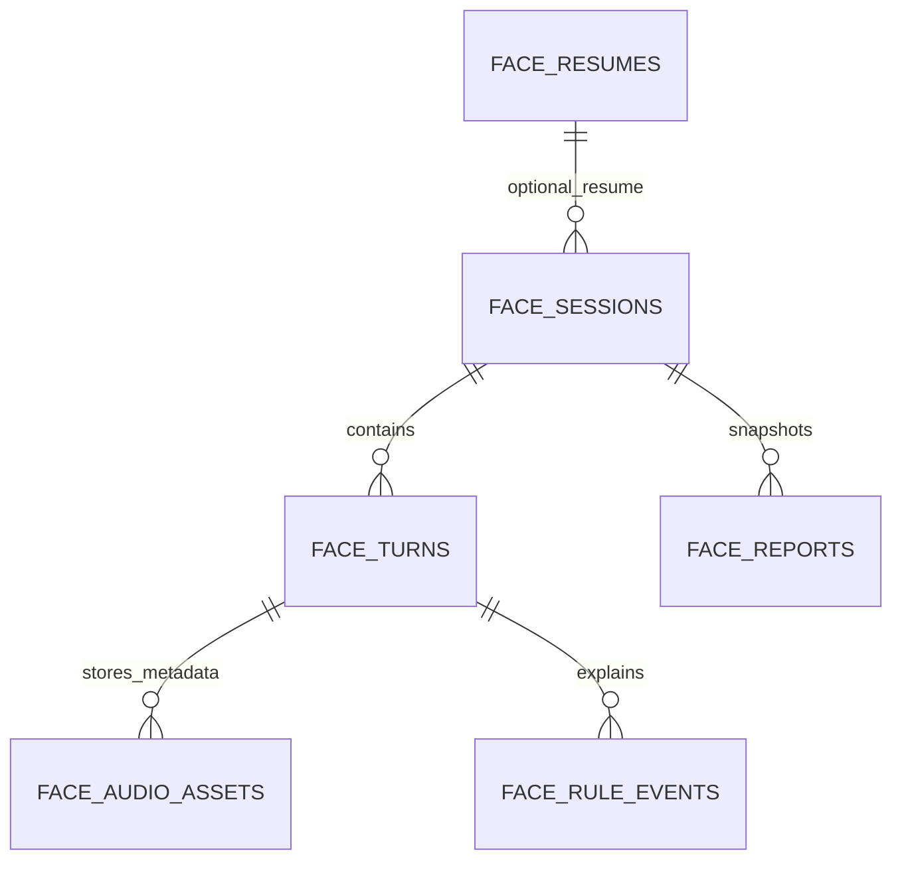

# 技术约束

> 版本 1.0 ｜ 更新 2026-11-03 ｜ 状态：基线（未决项见 [进度](进度.md) §4）
> 本文件约束"怎么实现"。业务规则看 [需求](../product/需求.md)。
> 旧技术规范（ARCHITECTURE / PROJECT_STRUCTURE / CODING_STANDARDS / API_CONVENTIONS / AI_INTEGRATION / SCORING_SPEC / SECURITY / TESTING / DEPLOYMENT / TECH_STACK / ADR）已归档到 `docs/archive/specs/`，细节以彼为准，冲突以本文件为准。

---

## 1. 分层与依赖方向

**1.0 起包含后端**（CR-1.0-007）。前端不再直连供应商，也不再持有密钥。

```
app/pages → features → 领域契约与 service 端口
app 装配适配器 → HTTP client（统一 /api/v1）
HTTP client → NestJS 后端 → TypeORM / node-oracledb → Oracle FREEPDB1
                        ├→ 本地磁盘（简历原件；音频后续）
                        ├→ 百度 OCR / ASR
                        └→ DeepSeek
评分：后端编排packages/shared/scoring纯内核 + 已校验AI结果（尚未实现）
```

| 层 | 职责 | 禁止 |
|---|---|---|
| `pages` | 页面组合、路由 | 调供应商、直连 DB、拼提示词、算分 |
| `features/*` | resume 接入、paper 组卷展示、session 状态机、scoring 展示、report 展示 | 导入 pages/app；深路径引用其它 feature |
| `components` | 通用展示 | 副作用 |
| `services/http` | 超时、重试、取消、队列、鉴权头 | 决定业务阈值 |
| `services/repositories` | 只做 API 仓储（1.0 不再有 IndexedDB 业务数据） | 偷改业务规则 |
| `packages/shared/contracts` | 跨端 DTO / Schema / 错误 | 依赖 src、React、DOM、NestJS、ORM |
| `packages/shared/scoring` | **纯内核**，前后端**同一份**实现 | 网络、存储、DOM、系统时钟、随机 |
| `packages/rules/scoring` | 阈值配置（版本化） | 把阈值写进算法 |
| `packages/ai/prompts` | 提示词版本资产（1.0 起由后端加载） | 在 UI 里硬编码 |
| `apps/api/` | **1.0 启用**：模块、基础设施、迁移 | 被前端深路径引用 |
| `apps/workers/` | 2.0 预留（本地模型） | 1.0 引用 |
| `infra/` | 3.0 预留 | 1.0 引用 |

**硬约束**：`shared` 不反向依赖；前端与后端**不得各写一份评分逻辑**——统一用 `packages/shared/scoring`；禁止 barrel 造成循环。

---

## 2. 标准项目结构（CR-1.0-010）

```text
Face/
├─ apps/
│  ├─ web/                    # 前端 npm workspace @face/web
│  │  ├─ src/                 # app/pages/components/features/services/state/domain/lib/styles
│  │  ├─ tests/               # 前端测试
│  │  ├─ index.html
│  │  ├─ package.json
│  │  ├─ tsconfig.json
│  │  └─ vite.config.ts
│  ├─ api/                    # NestJS后端（本轮核心模块已运行）
│  │  ├─ src/{modules,providers,infrastructure}/
│  │  ├─ migrations/          # 已执行Oracle建表与验证SQL
│  │  ├─ .env.example         # 空值配置模板，可提交
│  │  └─ .env                 # 仅本机，Git忽略，禁止提交
│  └─ workers/                # 2.0本地模型预留
├─ packages/
│  ├─ shared/{contracts,scoring}/ # 共享契约、纯规则内核
│  ├─ content/{bank,presets,templates}/ # 题库及公开内容资产
│  ├─ rules/scoring/          # 评分阈值与版本配置
│  └─ ai/{prompts,evaluations}/ # 提示词与脱敏评测资产
├─ product/
│  ├─ 需求.md                 # 唯一产品需求事实源
│  └─ prototype/              # 原型脚本、索引与PNG
├─ docs/                      # 技术约束、开发流程、进度
│  └─ archive/                # 历史留证，非当前事实源
├─ scripts/                   # 工程校验工具（不放业务逻辑）
├─ tests/                     # 仓库级工程规则测试
├─ infra/                     # 3.0部署与运维预留
├─ .github/                   # GitHub协作预留
├─ .githooks/pre-commit       # 本地Git提交前保密检查
├─ .gitignore
├─ AGENTS.md / README.md
├─ package.json / package-lock.json
├─ tsconfig.json
└─ eslint.config.js
```

所有命令在仓库根执行。当前只将实际可运行的apps/web注册为workspace；api、shared、rules等在实现运行包时再加入，禁止用空package伪装已完成工程。只有一个根锁文件，不在apps内另装第二套依赖/锁文件。

| 分域 | 放置/边界 |
|---|---|
| 前端页面 | apps/web/src/pages负责组合，components放公共展示，features放领域组件；其余层职责沿§1 |
| 前端测试 | apps/web/tests，只测试前端，不访问Oracle或第三方 |
| 后端 | apps/api/src，modules用例、providers供应商、infrastructure数据库/文件；当前仍未实现运行代码 |
| 共享代码 | packages/shared，禁止依赖React/DOM/NestJS/ORM；前端只读取评分类型 |
| 公开内容 | packages/content题库/预设/模板，禁止真实简历、录音、密钥 |
| AI/规则 | packages/ai与packages/rules，配置与实现分离 |
| 产品资料 | product，需求事实源与原型归此；不混入实现代码 |
| 工程文档 | docs，当前规范/进度/流程；archive只留历史，不反向覆盖现行决议 |
| 工程脚本/测试 | scripts与根tests，组件与公开仓库检查，不放业务算法 |
| 本地数据/配置 | apps/api/.env及apps/api/data，仅本机，Git忽略 |
| 部署/模型 | infra与apps/workers留后续版本，当前不实施防攻击或公网部署 |

迁移只调整路径、导入、配置和文档，不重建Oracle、不轮换数据库账号、不改原型/题库内容或SQL字节。锁定的空旧目录如被编辑器占用，可在关闭编辑器后移除；Git不会提交空目录。禁止新增重复目录级README。

## 3. 编码规范

### 3.1 命名

| 对象 | 规则 |
|---|---|
| 目录/普通文件 | kebab-case |
| React 组件/文件 | PascalCase（`ScoreReportPanel.tsx`） |
| Hook | `useXxx` / `use-xxx.ts` |
| 函数/变量 | camelCase，函数用行为动词 |
| 布尔 | `is/has/can/should` |
| 类型 | PascalCase，不加 `I` 前缀 |
| 常量/环境变量 | UPPER_SNAKE；**`VITE_*` 仅公开配置** |

### 3.2 类型

- 开 `strict`、`noImplicitAny`、`strictNullChecks`，推荐 `noUncheckedIndexedAccess`。
- 外部输入、存储旧值、导入文件、规则配置一律 **按 `unknown` 接收后运行时校验**。
- **禁止** 滥用 `any`、双重断言、`!`、`@ts-ignore` 绕过契约。
- 契约以 Schema 为事实源、类型派生；**同一契约不得手写两套**。

### 3.3 错误与日志

- `AppError { code, module, retryable, userMessage }`；用户响应不含堆栈。
- 用户提示必须给**可执行操作**：重试 / 重录 / 手填 / 跳过 / 降级。
- 面试流程**禁止 `alert` / `confirm`**。
- 异步结果必须校验所属 `session/turn`，取消后的旧结果不得覆盖新状态。
- 日志只记时间、级别、模块、错误码、耗时、`requestId`、用量；**禁止正文、录音、凭证**。
- **禁止** 空 catch、吞错后标成功、缺失评分默认成 0 或满分。

### 3.4 提交与评审

`type(scope): 描述`；分支 `feat/fix/docs/chore`。PR 必须含：版本、变更编号、影响面、契约、验证证据、隐私与回滚。**未运行的检查必须明说**。

---

## 4. 接口与错误码

- 前端只调 `/api/*` 相对路径，不写死域名，不出现密钥。
- 时间用 UTC ISO8601，媒体偏移统一毫秒且相对音频起点。
- ID 为不透明字符串；文件走 `multipart/Blob`，不在 JSON 里塞大体积 base64。
- 单一重试层：重试、退避、`Retry-After`、限流、取消、`requestId` 全在 `services/http`。

**错误码（1.0 全量）**

| code | 触发 | 用户可见动作 | 可恢复 |
|---|---|---|---|
| `E_API_DOWN` | `/api/health` 不通 | 提示启动后端与 db，页面转只读 | 是 |
| `E_DB_DOWN` | 后端连不上数据库 | 提示检查容器，操作禁用 | 是 |
| `E_UNAUTHORIZED` | 无/过期 token | 跳登录 | 是 |
| `E_FORBIDDEN` | 跨 `ownerId` 访问 | 提示无权限，记审计 | 否 |
| `E_KEY_MISSING` | 后端缺 Key | 提示配置 `.env`（不暴露给前端细节） | 是 |
| `E_RATE_LIMIT` | 429 | 自动退避 3 次 | 是 |
| `E_QUOTA_EXCEEDED` | 额度用尽 | 降级 D1/D2 | 当天否 |
| `E_TIMEOUT` | 上游 >30s | 重试 1 次 | 是 |
| `E_ASR_EMPTY` / `E_ASR_LOW_CONF` | 空/低置信 | 重录或手填 | 是 |
| `E_OCR_LOW_QUALITY` | 文本 <200 字或乱码 >30% | 手填 | 是 |
| `E_LLM_SCHEMA` / `E_LLM_QUOTA` | 校验失败 / 超限 | 规则兜底 | 是 |
| `E_AUDIO_PERMISSION` / `E_AUDIO_TOO_SHORT` | 拒权 / <1.5s | 引导 / 重录 | 是 |
| `E_BANK_INSUFFICIENT` | 可得题不足 | 减题或换方向 | 是 |
| `E_ILLEGAL_TRANSITION` | 状态机非法 | 回退 asking | 是 |

`/api/health` 返回 `{ ok, mode: 'local', hasKey, db: 'up' | 'down', version }`（D10 最小集，不扩展为正式 API）。

---

## 5. 存储（CR-1.0-008：本机Oracle）

Oracle为业务事实源，浏览器只存UI偏好。1.0不建users，不引入ownerId、JWT或伪造固定用户。运行账号FACE_RUNTIME与产品登录无关。

| 表 | 用途 | 关键约束 |
|---|---|---|
| FACE_RESUMES | 原文、结构、疑点、不确定字段、解析置信度 | source枚举、JSON、概率0–1 |
| FACE_SESSIONS | 岗位/试卷/版本快照、状态、断点、乐观锁 | 状态枚举、简历外键、lock_version |
| FACE_TURNS | 题目、回答、转写、两层追问、AI/评分快照 | session+turn_index唯一，session+request_key幂等 |
| FACE_AUDIO_ASSETS | 相对路径、类型、体积、sha256、过期/删除状态 | 复合外键防跨会话关联、路径唯一、防目录穿越 |
| FACE_RULE_EVENTS | 正数points、加扣方向、证据、阈值快照、置信度 | APPLIED证据必填、真实概率来源、不允许derived |
| FACE_REPORTS | 带revision的不可变报告快照 | 会话+revision唯一，分数/区间互斥，运行账号无UPDATE |
| FACE_AUDIT_LOGS | 请求/动作/资源/结果 | 无正文、无凭证；运行账号只能SELECT/INSERT |
| FACE_MIGRATIONS | 版本、DDL SHA-256、应用时间 | 非业务表；运行账号只读 |

字段、类型、默认值、外键和CHECK的唯一物理定义为[001 DDL](../apps/api/migrations/001-initial-oracle.sql)，不要另写一套实体后开启synchronize覆盖。JSON用CLOB+IS JSON STRICT；对象快照要求唯一键；JSON结构/版本/数值语义仍须服务端运行时校验，不把IS JSON等同业务Schema。CLOB为空与Oracle空字符串视NULL须显式映射。

ID为不透明字符串，默认SYS_GUID生成32位十六进制；允许36位UUID输入。时间用TIMESTAMP WITH TIME ZONE，API统一UTC；媒体偏移毫秒；索引/实体表名显式大写且schema=FACE_APP。更新updated_at与lock_version由仓储事务负责，不依赖隐藏触发器。

音频走磁盘adapter，应用生成相对路径，禁止客户指定路径；文件写临时区→校验→移动→标记ready，失败要可补偿。默认7天留存由配置传入expires_at；元数据不存音频字节，不暴露原路径为公开URL。

迁移使用版本化SQL+FACE_MIGRATIONS校验和，TypeORM仅数据访问。synchronize=false，启动不自动迁移；不得让TypeORM默认迁移表误接管现有账本。Oracle DDL自动提交，失败可能部分生效；禁止靠ROLLBACK假装能撤销DDL，禁止未经检查重跑001。

## 6. 当前保密要求与3.0安全边界（CR-1.0-010）

按需求方最新指示：1.0/2.0按本机常规流程使用，不建设针对非常规使用/攻击的鉴权、WAF、Host/Origin攻击拦截、安全限流、防爬、SSRF或入侵检测。3.0服务器部署时再评估并实施。正常错误处理、类型/数据校验、数据库约束和成本队列属于正确性/可用性，继续保留。

**当前必须实现的只有公开仓库保密边界：**

- 密码、API Key、Token、钱包/私钥与真实简历/音频/报告/数据库导出不进Git、源码、示例、日志或构建产物。
- 真值只在后端进程环境变量或apps/api/.env；.env.example只给变量名和空密码，禁止可用默认秘密。
- VITE_*只允许公开配置；把Key放进前端环境变量仍会进入bundle，禁止。调用供应商必须在后端；前端不接收Key。
- .gitignore排除各层.env/.env.*（只放行.env.example）、运行数据、音频、日志、Oracle导出/钱包/私钥、依赖与产物。
- .gitignore不能清除已经入索引/历史的内容。check:public同时检查待提交文件、工作区和暂存区；新增.secret即使强制暂存也应拒绝。不得用git add -f绕过保护。
- 提交前执行npm run check:public。自定义pre-commit仅检查泄露，不连接数据库，不执行防攻击功能；启用方式见README。
- 检查打印路径/行号/规则，不打印命中值。检测是辅助，新增凭证格式/二进制隐私文件仍须人工核对；不得声称公开代码本身能保证任何外部服务绝不被攻击。
- 若真值已进入公开提交，必须先吊销/轮换，再处理历史；不能只加ignore继续用。当前仓库无历史提交，已核验本机密码不在可提交集合。

本机API仍使用回环地址作为运行方式，不扩展公网服务。已有数据库权限维持不变，本轮不新增攻击防护系统。隐私说明仍区分本机DB/磁盘与第三方识别，不因延后网络安全而取消告知。

## 7. 测试

| 类型 | 范围 |
|---|---|
| 单元 | 规则边界、互斥档位、封顶、去重、不可评估、配额分配 |
| 集成 | 仓储、迁移、删除、取消、重试 |
| 契约 | AI 三任务 Schema、供应商返回、旧数据可读 |
| E2E | 主流程、断点恢复、四条降级 |

- 普通 CI 用脱敏 fixture，**不调用付费 API**。
- 不得镜像实现写无意义测试；不得凭空生成题库当作审核结果。
- AI 八条回归用例必须全过（见 [需求](../product/需求.md) §5）；额外测注入、伪造引用、截断 JSON、越界、缺 `bases`、未知字段。
- 规则重复执行必须完全一致；AI 波动 ≤5 分。

---

## 8. 部署与工程（本机单用户）

```text
web Vite :5173 → /api/v1 → NestJS :3000 → Oracle :1521/FREEPDB1
                                  └→ 本地磁盘音频adapter
```

008/010历史状态曾仅建表。当前011已启用NestJS运行工程与核心API；根dev同时起前后端。已迁为标准单仓结构：apps/web是前端workspace，apps/api是后端目录，packages独立承载共享代码与资产。

API默认127.0.0.1供本机正常使用；Host/Origin攻击校验、攻击防御和公网加固统一留3.0。本期不做相关防护开发。1.0不启用Redis/队列/对象存储/本地模型，不建登录/注册。

数据库本机已运行，不创建Postgres Docker容器。连接凭证在被忽略apps/api/.env，密码不进入CLI参数、源码、日志或聊天。FACE_APP是无登录对象所有者，FACE_RUNTIME只有CREATE SESSION和指定对象DML；后端绝不使用SYS。schema必须显式FACE_APP，不能假定运行账号默认schema。

测试使用脱敏fixture；常规CI禁止连开发者个人Oracle。DB集成测试必须指向隔离schema，禁止test自动清现有业务库。check包含格式/lint/类型/组件门禁/前端测试；待后端创建再补server检查，不能伪称已覆盖后端。

2.0：模型worker、动作、队列与对象存储；3.0：网关、TLS、监控、备份、灰度。

## 9. 选型（方向已定，精确版本在安装阶段冻结）

| 领域 | 选型 | 备注 |
|---|---|---|
| 前端 | React 18 + TS strict + Vite + Tailwind | 不引大型 UI 库 |
| 路由 | React Router | 静态回退与错误页 |
| 状态 | Zustand + 局部 state | 不全量持久化 UI |
| 表单上传 | React Hook Form + File API | 大小/类型/内容检查 |
| PDF | PDF.js（按需加载） | 文本层提取，扫描件转手填 |
| 校验 | Ajv（draft-07）+ 表单 Zod | 同实体不双写 Schema |
| 本地数据 | **不再使用**（1.0 起业务数据全在服务端） | 前端只存UI偏好 |
| 测试 | Vitest / Testing Library / MSW / Playwright / Supertest | 后端用 Supertest 做接口测试 |
| 后端 | **NestJS + TypeORM + node-oracledb + Oracle**（1.0启用，运行工程待创建） | 模块化单体，不提前微服务化 |
| 队列 | 1.0 同步调用 + 重试；**BullMQ 留 2.0** | 单用户并发低，不值得上队列 |
| 文件存储 | 1.0 本地磁盘 + adapter；2.0 换 S3 | 调用方不感知实现 |
| 部署（3.0） | Docker + Nginx + GitHub Actions | 无容量证据不引 K8s |

**版本策略**：核验官方支持与安全公告后锁定精确版本与 lock 文件；禁止 `latest`、禁止浮动镜像。

---

## 10. 决策记录（ADR）

| ADR | 结论 |
|---|---|
| ADR-001（已修订） | 1.0前后端+Oracle，apps/workers与infra留后续；前端apps/web/src、跨端/AI/规则分域保留，评分后端唯一实现 |
| ADR-002 | Oracle现有环境适用；NestJS+TypeORM+node-oracledb替代Prisma/Postgres；1.0管理员Cookie登录（011替代无登录） |

## 11. 静态预览工程（CR-1.0-005 · 2026-11-03）

本轮有限授权使用React18、TS严格模式、Vite、Tailwind和React Router。只装静态UI必要依赖，Zustand/表单/识别/存储等待业务阶段引入。公共展示位于components，路由在app，8视图在pages，全局/响应式样式在styles。JSX示例不作为业务DTO、题库或算法。全局静态标记，业务按钮disabled，输入readOnly/disabled，仅导航具备交互。

命令：npm ci、npm run dev、npm run check、npm run build。check执行ESLint、tsc和静态页面边界测试；不是业务验收。Vite只监听127.0.0.1，**静态阶段不配代理、不读密钥**（CR-1.0-007 起业务阶段加 `/api → 127.0.0.1:3000` 代理，见 §8）。构建目标Chrome120/Edge120/Safari17，精确依赖见package.json与锁文件。**业务范围按 §8 与开发流程 R4–R16（CR-1.0-007 重编，旧 R5–R15 作废）。**

验证版本信息：[Vite](https://vite.dev/guide/)、[React Router](https://reactrouter.com/start/declarative/installation)。当前Node22.22.1满足所选工具engines。

## 12. 组件化开发强制规范（CR-1.0-009，替代006旧刻度）

职责单一与变化原因隔离优先，行数仅信号。统计Prettier格式化后的物理行（含空行/注释），禁止压行规避。单个组件文件≤200推荐；201–300只关注，不能凭行数强拆；301–500发拆分警告，必须拆分或在进度给具体保留理由；>500必须拆，无例外。文件与组件/Hook分别检查，CSS沿用文件规模检查。源TS/TSX/CSS参与，题库、依赖、生成物和归档不参与。

保留理由记录：`组件保留理由: apps/web/src/路径[#函数] | 职责、变化原因、为何暂不拆`。仅留TODO或一个空“计划”不算理由；改动命中该模块时重新审视，不能无限延期。

### 12.1 辅助拆分候选阈值

| 信号 | 阈值 | 执行 |
|---|---|---|
| Props | >10个（含类型展开） | 审视接口/数据归属，不用一个大对象隐藏数量 |
| Props透传 | ≥3条父子传递边，即A→B→C→D | 审视组合/状态归属，不机械引入全局store |
| useEffect | ≥3个 | 分离副作用原因，禁止合并无关effect以压数量 |
| useState | ≥6个 | 审视内聚状态/子组件/reducer，不一律改全局 |
| JSX嵌套 | >3层 | 标候选，审视可读性，不为div建壳 |
| 圈复杂度 | >10 | 审视分支与用例分离 |

任一命中即候选，不自动判缺陷或强制拆。<50行且职责单一，或抽出子组件<10行，不强制拆。只出现1次且无复用预期不强抽；相同UI/逻辑≥2次必须公共化，结合上述不抽下限，不能据此创建一堆微组件。

### 12.2 边界与复用

通用展示在components，领域组件在features，pages负责组合；业务不能为减少行数搬入通用UI。props显式类型且最小化，禁止万能组件/布尔模式堆积/逐层透传整个store。Hook仅承载真实复用或独立副作用；纯函数不伪装Hook。

相同UI包括仅文案/值不同的相同结构，逻辑复用按职责判断，不能用重命名掩盖。当前Card/Badge/Notice/Button/Field/Heading/Steps等已复用；单次独立面板不是强制继续拆分的理由。

### 12.3 自动与人工边界

npm run check包含格式、lint、类型、组件扫描和测试；check:components使用TS AST统计Props/Hook/JSX/近似圈复杂度，支持可解析组件别名的直接属性透传链、非微小精确JSX重复。匿名动态组件、运行时spread/条件合成、语义相似逻辑不能完全静态判定，必须评审；禁止声称工具覆盖了全部语义复用。精确重复先标候选，评审按≥2复用与<10行豁免落实。

>300无具体理由、>500任何情况均失败。辅助候选仅告警，不为了通过检查增加无意义组件。圈复杂度按决策节点近似（if/循环/case/catch/条件表达式/短路运算），不冒充全程序运行时路径数。

当前候选主要是静态页面与已抽面板的JSX容器深度：单次展示且无状态，保留合理的语义/布局层级。<50行面板适用下限；其余页面已隔离领域变化原因，不为嵌套层数继续造壳。业务接入新增状态时重新评估。

## 13. 后端决策与Oracle实建（CR-1.0-008）

### 13.1 架构决策

NestJS模块化单体+TypeORM DataSource仓储+node-oracledb Thin+Oracle；模块为resume/paper/session/scoring/report/audio，基础设施封装Oracle、文件、上游HTTP与日志。controller只做协议/常规输入校验，service做用例与事务，repository负责持久化，provider负责百度/DeepSeek转换；shared不依赖框架，评分只有后端调用的一份纯内核。队列/本地模型留2.0。

Oracle现有26ai Free 23.26.3适合本机MVP，无需另装Postgres。Prisma官方数据库清单不含Oracle，所以替换数据访问层，不把Prisma接Oracle伪装成开箱支持。使用CLOB JSON+关系字段兼顾Oracle兼容与未来迁移，避免不必要的向量/数据库AI特性。Free版本容量/资源限制应在未来规模化时评估，当前不承诺生产容量。

连接、事务与查询绑定必须经repository；无ORM自动同步，字段到DTO显式映射、读取CLOB后再校验JSON；JSON字段不承载明文秘密。NestJS/TypeORM/driver精确版本与集成包peer矩阵在后端工程安装阶段验证，当前仅SQLPlus实际连通，不宣称Node驱动已联调。

### 13.2 实际环境与授权记录

2026-11-03检查：OracleServiceFREE与监听运行；Oracle AI Database 26ai Free Release23.26.3.0.0；FREEPDB1 READ WRITE；监听服务127.0.0.1:1521/FREEPDB1可用。需求方明确确认新建FACE_APP/FACE_RUNTIME并执行建表。仅新增专用对象，未修改原有PDBADMIN与系统表结构；管理员用于受控DDL，凭证不在应用运行配置。

FACE_APP NO AUTHENTICATION，USERS表空间配额256MB；FACE_RUNTIME只有CREATE SESSION、指定7业务表DML/受限写入及迁移表只读，无DBA角色、无DDL权限。报告不授UPDATE，审计不授UPDATE/DELETE。schema拥有者的审计清理必须是未来显式管理任务，不由运行账号执行。

### 13.3 DDL与关系

- [001建表/约束/索引](../apps/api/migrations/001-initial-oracle.sql)：只允许FREEPDB1/CURRENT_SCHEMA=FACE_APP，已存在目标表即拒绝，禁止盲重跑。
- [002运行权限](../apps/api/migrations/002-runtime-grants.sql)：初始化账号由本轮受控管理员创建，SQL本身无密码。
- [003只读验证](../apps/api/migrations/003-verify-oracle.sql)：管理员检查表/约束/索引/授权。
- [004约束与权限冒烟](../apps/api/migrations/004-smoke-test-oracle.sql)：以FACE_RUNTIME执行，合成数据全部ROLLBACK，不在普通CI自动调用个人库。



外键不级联盲删；音频复合外键强制session/turn一致。报告区间行不存点值；未可评估可留NULL，不填0。业务Schema仍负责区间口径和阈值，数据库CHECK不硬编码评分阈值。报告是不可变快照，不能仅凭现行规则“重建历史分数”，只能读取历史输入/版本/结果并新增修订。

已验证8表、全部约束ENABLED/VALIDATED、索引VALID；14条连接/约束/权限PASS，合成行已回滚，仅迁移账本有1条初始化记录。008时尚未导入题库；011已新增005迁移、Oracle仓储与200题种子，未启用ORM自动建表或清理任务。

### 13.4 后续工程与配置

apps/api/.env已生成并被忽略，包含DB_USER/DB_PASSWORD/DB_CONNECT_STRING/DB_SCHEMA/API_HOST/API_PORT；不得输出或提交。模板仅有空密码。数据库角色不是产品登录，1.0不建立用户表。未来多用户需要另行设计身份、owner迁移、资源过滤与审计主体，不提前塞入当前实现。

先创建NestJS空工程、验证Thin连接/事务/CLOB映射，再做repository与health；健康返回不包含凭证、内部SQL或schema细节。之后按R5/R7业务轮次逐步接入，不本轮实现业务API。

官方依据：[TypeORM Oracle](https://typeorm.io/docs/drivers/oracle/)、[node-oracledb安装/Thin支持](https://node-oracledb.readthedocs.io/en/latest/user_guide/installation.html)、[Prisma数据库清单](https://docs.prisma.io/docs/orm/core-concepts/supported-databases)。

| 版本 | 日期 | 变更 |
|---|---|---|
| 1.2 | 2026-11-03 | CR-1.0-008：Oracle实建、本机无登录与后端分层；CR-1.0-009：新组件阈值与候选/复用/下限 |

## 14. 公开仓库整理记录（CR-1.0-010 · 2026-11-03）

根npm run dev/build/preview转发@face/web；check包含公开保密检查、格式、lint、类型、组件门禁及测试。npm run validate:bank只读校验packages/content/bank，不更新索引。npm ci只依据根锁文件恢复依赖；后端暂无package.json/启动脚本，不创建虚假后端启动命令。

迁移前后的真实.env仅路径改变，密码未变也未展示；四份Oracle SQL未改内容，不在本轮执行数据库操作。Git尚无历史提交，用户自行提交/推送；本轮不执行git commit/push。

| 版本 | 日期 | 变更 |
|---|---|---|
| 1.3 | 2026-11-03 | 010标准目录与web workspace；公开仓库保密检查；防攻击需求移至3.0 |


## 14. 核心运行架构与接口（CR-1.0-011）

### 14.1 工程与依赖

三个npm工作区：`@face/shared`先生成跨端Zod契约，`@face/api`为NestJS模块化单体，`@face/web`为React。精确版本以各package.json及唯一package-lock.json为准。当前采用Nest12、TypeORM1、node-oracledb26 Thin、Zod4；显式注入OracleStore，不启用ORM同步/自动迁移。所有SQL绑定参数，CLOB按字符串读取并校验。事务通过QueryRunner，模块初始化等待同一个连接就绪Promise。

后端模块：`modules/auth`认证；`modules/resume`原件和文字；`modules/practice`题库配额/练习与答案；`providers`只封装文档提取与百度；`infrastructure`数据库/错误；`config.ts`集中读取配置。前端`features`组合UI与自定义Hook，`services/repositories/core-api.ts`统一领域请求，`services/http/client.ts`统一Cookie/错误/超时/运行时校验，禁止页面直连供应商。

HTTP普通请求30秒；涉及上传/重新识别960秒（覆盖最多30页、每次上游30秒）。上游不自动重试，避免付费重复；由用户显式重试。当前识别为同步请求，同一进程同简历拒绝并发识别，重启遗留processing时可重试；不承诺断点续页或后台任务持久化。Word读取文字层，不识别内嵌图片；PDF拼接页分隔为两个换行，逐页words_result中的行顺序按百度原输出展示，不承诺还原复杂多栏版式。OCR失败不返回虚构文本。

### 14.2 统一配置和保密

唯一私密文件`apps/api/.env`；模板空密码/空AK/SK。DB_USER/DB_PASSWORD/DB_CONNECT_STRING/DB_SCHEMA管理连接；ADMIN_USERNAME/ADMIN_PASSWORD管理初始账号；BAIDU_AK/BAIDU_SK/BAIDU_OCR_ENDPOINT管理OCR；UPLOAD_MAX_MB/PDF_MAX_PAGES、AUTH_TTL_HOURS、API_HOST/API_PORT/WEB_PORT管理运行。API_HOST固定回环；端口由Vite服务端读配置，严禁把整个env暴露至浏览器。数据库schema本轮固定FACE_APP，库口令不会被应用自动修改。

初始密码仅存本机env，数据库存随机盐+scrypt，登录令牌32随机字节，仅SHA-256写DB，HttpOnly/SameSite=Lax本机Cookie，默认12小时。初始账号不存在则建，配置口令改变会重哈希并注销该账号旧会话；不公开注册/重置密码接口。改ADMIN_USERNAME会创建新配置账号，不承诺删除旧账号。禁止日志记录口令/令牌/OCR请求体/原文。这里只落实常规账号归属和仓库保密，公网攻防留3.0。

### 14.3 005迁移与存储

`005-core-workflow.sql`已在FREEPDB1/FACE_APP执行并登记SHA-256，禁止重跑。新增FACE_USERS、FACE_AUTH_SESSIONS、FACE_TOPICS、FACE_QUESTIONS；原FACE_RESUMES增加owner/文件/修订/OCR页与状态，FACE_SESSIONS增加owner。现为12张表（11业务+迁移账本）。新增owner非空基于原库无业务数据前提；有旧业务数据的其他环境必须先制定归属回填，不能直接执行005。

原件：`apps/api/data/resumes/<owner UUID>/<resume UUID>.<ext>`；实际相对路径仅后端使用，下载须先按owner查DB。不将data设为静态公开目录。原件先写文件再插metadata，metadata失败清理刚写的文件；提取失败保存原件/错误状态，支持再次提取。磁盘和DB无法跨介质事务，不宣称已具备自动孤儿清理。列表当前无分页，面向本机少量记录；共享DTO返回受控字段，不返回哈希、令牌或磁盘路径。

题库MERGE只补缺失，不覆盖修改；前端不引用种子JSON。题目快照随练习冻结，`request_key=question.id`避免Oracle复合唯一键空值冲突；保存回答事务先锁定本人session，再校验turn归属，更新完成数/状态。不产生评分副作用。

### 14.4 可用API契约

基址`/api/v1`，成功直接返回共享Zod DTO，不套第二层data；失败固定`{error:{code,message}}`。未知异常统一E_SERVER，禁止把SQL/bind/堆栈发给浏览器。写接口无自动重试，新增练习请求非幂等，UI禁重复提交。全部业务接口要求Cookie；`/api/health`为无私密信息的连库检查。

| 方法/路径 | 输入 | 输出 |
|---|---|---|
| POST /auth/login | username,password | User + HttpOnly Cookie |
| GET /auth/me | — | User |
| POST /auth/logout | — | {ok:true}，注销Cookie与DB会话 |
| GET /settings | — | OCR是否配置/公开限制，不含凭证 |
| GET /resumes | — | 本账号ResumeSummary[] |
| POST /resumes | multipart单文件file | Resume，解析失败也返回已保存对象及failed状态 |
| GET /resumes/:id | — | 本人Resume |
| GET /resumes/:id/file | — | 本人原件附件 |
| PUT /resumes/:id/text | {text} | Resume修订副本 |
| POST /resumes/:id/recognize | — | Resume重新提取结果 |
| GET /topics | — | 数据库Topic[]，含可用题数 |
| POST /practices | {weights,count,resumeId?} | Practice + 题目快照，无参考答案 |
| GET /practices | — | 本人历史（题数/已回答数） |
| GET /practices/:id | — | 本人题目与已保存回答 |
| PUT /practices/:id/answers/:turnId | {text} | 更新后的Practice |

状态：查询/PUT 200，POST默认201；401未登录/过期/凭证错误，404资源不存在或不属于本人，400输入/题型/配额错误，409识别进行中，500统一内部异常。OCR错误通过Resume.error+status返回，不能仅检查HTTP成功就标记识别成功。错误码包括E_VALIDATION/E_AUTH/E_NOT_FOUND/E_FILE_TYPE/E_FILE_FORMAT/E_WEIGHTS/E_TOPIC/E_BANK_CHANGED/E_OCR_CONFIG/E_OCR_AUTH/E_OCR_NETWORK/E_OCR_UPSTREAM/E_SERVER；以代码和共享运行时契约为精确事实源。

### 14.5 组件审视与验证

AnswerWorkspace将题目目录抽为QuestionIndex、请求/保存状态抽为useAnswerWorkspace；上传、列表、原文核对各自成组件，公共Action/Feedback/PageHeading复用。ResumeDocument低于200行、单份文档核对职责，暂不为源文/修订的单次布局再造壳；ResumeUpload独立承担文件选择/确认，分支复杂度候选已审视。两个工作区Hook分别处理领域状态，没有跨领域状态混放。CSS按登录、顶栏布局、文档列表、编辑器、练习、公共原语分域，均小于300行。

`npm run check`为格式/lint/strict/组件/单元+OCR模拟契约；`npm run test:integration`要求本机API已启动，真实Oracle合成验证后只清理本次UUID，不清理现有资料；不作为真实百度验收。浏览器另验登录、DOCX上传、原文与修订、题目/回答、记录及桌面/手机无横溢出。当前不实现评分、追问、ASR、DeepSeek、本地模型或公网发布。

| 版本 | 日期 | 变更 |
|---|---|---|
| 1.4 | 2026-11-03 | 011核心运行工程、12表、Cookie归属、OCR适配与接口契约 |
